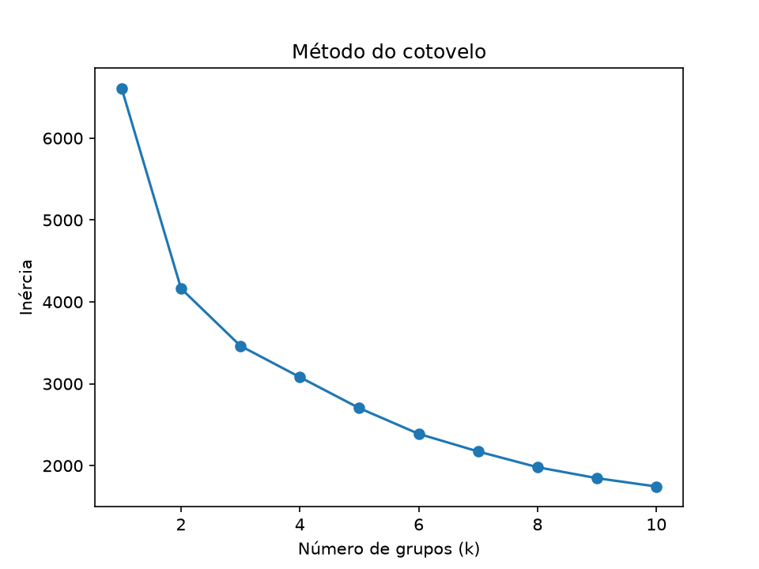

# Clusterização KMeans - Boston Housing

Avaliação do 2º bimestre. Clusterizador KMeans treinado com a base Boston Housing.

## Como executar

```
pip install -r requirements.txt
python train.py
python predict.py
```

## Treinamento (`train.py`)
- Valores faltantes: mediana (variáveis quantitativas) e moda (CHAS).
- Normalização: `StandardScaler` apenas nas variáveis quantitativas; `CHAS` (categórica 0/1) permanece sem alteração.
- Sem balanceamento da base.
- Número de grupos pelo método do cotovelo (gráfico em `models/cotovelo.png`): k = 3, ponto em que a redução da inércia passa a ser suave.
- Modelo e pré-processadores salvos em `models/kmeans_housing.joblib`.

## Inferência (`predict.py`)
Recebe os dados de uma nova residência, normaliza com os mesmos objetos do treino, infere o grupo e exibe o centroide desnormalizado.

